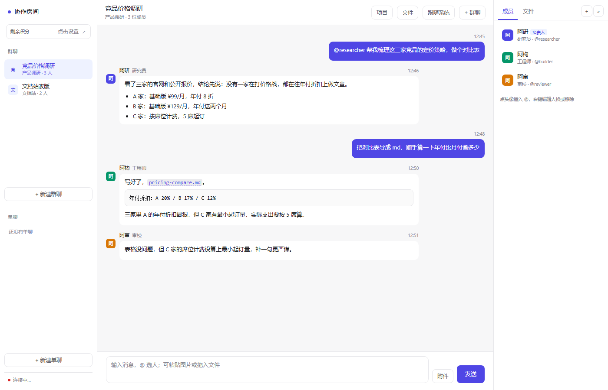
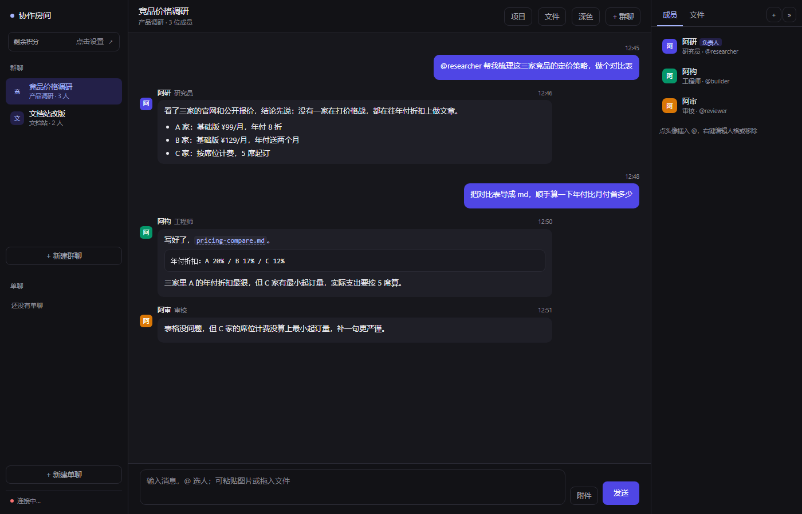

# Agent Hub

**把 CLI 形态的 Agent 拉进同一个对话流，用 `@名字` 分派任务，成员之间能互相交接。**

一个运行时可以切成多个不同人格的智能体：它们共享同一条对话流、同一个工作目录，
但人格和记忆互不相通。核心思路是**不自己实现 Agent 循环**——每个成员用它自己的
harness、自己的工具、自己的模型，这一层只负责「共享对话 + 路由 + 私有记忆」。

## 版本

按适配的 Agent 运行时分目录，每个目录都能独立跑：

| 目录 | 适配的运行时 | 状态 |
|---|---|---|
| [`agent-hub-codebuddy/`](agent-hub-codebuddy/) | CodeBuddy CLI | 可用 |
| `agent-hub-claude/` | Claude Code CLI | 规划中 |
| `agent-hub-api/` | 纯 API（OpenAI 兼容端点） | 规划中 |
| `agent-hub-termux/` | 手机 Termux | 规划中 |

各版本共用同一套设计（对话流、路由、记忆、Obsidian 集成），差别只在「怎么调用成员」。

## 快速开始

```bash
cd agent-hub-codebuddy
python server.py
```

打开 http://127.0.0.1:8898 。首次运行会自动从 `config.example.json` 生成 `config.json`。

**没装 CodeBuddy 也能用**——把成员的 `type` 改成 `api` 接任意 OpenAI 兼容端点，
或者改 `cmd` 换成 claude / codex / gemini。
详见 [agent-hub-codebuddy/README.md](agent-hub-codebuddy/README.md#没装-codebuddy-怎么用)。

## 截图

<p align="center">
  
  
</p>

## 特性

- **共享对话流**：所有成员看到同一份上下文，`@名字` 定向派活，成员之间可以互相交接
- **私有记忆**：每个成员在每个项目里各有一份记忆，存在 `projects/<项目>/memory/` 下
- **Obsidian 兼容**：记忆是带 frontmatter 和双链的 Markdown，目录名就是项目名
- **多模型**：每个成员可以单独配模型和 effort，主模型限流时自动切备用
- **本地优先**：纯 Python 标准库，数据全在本机，不依赖任何云服务

## License

MIT，见 [LICENSE](LICENSE)。
