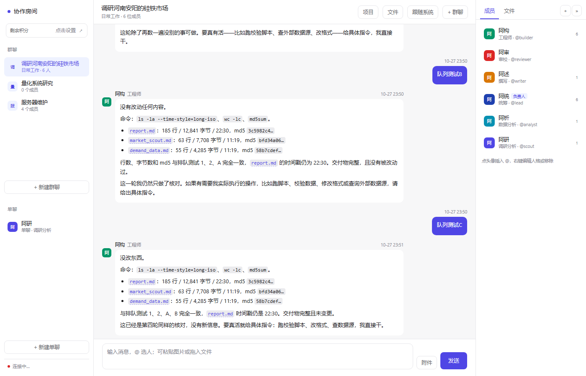

# Agent Hub · 本地多智能体协作房间

**把 CLI 形态的 Agent 拉进同一个对话流，用 `@名字` 分派任务，成员之间能互相交接。**

<p align="center"></p>

一个 codebuddy 可以切成多个不同人格的智能体：它们共享同一条对话流、同一个工作目录，
但人格和记忆互不相通。核心思路是**不自己实现 Agent 循环**——每个成员用它自己的
harness、自己的工具、自己的模型，这一层只负责「共享对话 + 路由 + 私有记忆」。

## 它解决什么问题

- **上下文不爆**：一个 Agent 干所有事，历史很快塞满；拆成多个角色各管一段
- **视角互补**：研究、实现、审校分开跑，互相挑毛病能揪出单角色漏掉的问题
- **记忆不串味**：记忆按「成员 × 群聊」隔离，一个项目一套上下文

## 前置要求

- **Python 3.10+** —— 只用标准库，不需要 `pip install` 任何东西
- **Node.js 18+** —— 用来装 codebuddy
- **[CodeBuddy CLI](https://www.codebuddy.ai)** —— `npm install -g @tencent-ai/codebuddy-code`，首次使用需登录

## 安装

```bash
git clone https://github.com/YOUR_NAME/agent-hub.git
cd agent-hub
cp config.example.json config.json     # 首次运行需要它
python server.py                       # 打开 http://127.0.0.1:8898
```

## 内置示例成员

下面四个只是**演示用的种子数据**，在界面上可以随便改人格、删掉、或者从模板库加新的。

| 名字 | 人格 | 角色 | 性格 |
|---|---|---|---|
| `researcher` | 阿研 | 研究员 | 冷静克制，对模糊表述过敏，只给有据可查的判断 |
| `builder` | 阿构 | 工程师 | 务实寡言，只关心东西能不能跑 |
| `reviewer` | 阿审 | 审校 | 尖锐挑剔，专门找别人不想看到的问题 |
| `writer` | 阿述 | 撰写 | 耐心有条理，把乱麻理成线 |

同一个模型（deepseek-v4.1-flash + ultracode），靠 system prompt 区分人格。
实测效果：

> **researcher**：阿研，研究员。我负责把问题拆开，查证事实，给出有据可查的判断；我不动手改东西，也尽量不使用「大概」这类词。
>
> **builder**：阿构。写代码、改文件、跑命令，能跑起来才算数。

---

## 快速开始

**Web 界面（推荐）**

```bash
cd agent-hub
python server.py          # 打开 http://127.0.0.1:8898
```

界面上能做的事：

- **左侧**：群聊列表，点「+ 新建群聊」；右键群聊可删除
- **新建的群聊是空的**，没有任何成员。点右侧「+ 添加」从已有成员里挑，
  或者点「+ 新建成员」当场造一个（造完自动加入当前群）
- **右侧**：成员卡片，**左键插入 @，右键编辑**。编辑弹窗分两个 tab：
  「人格设定」（全局）和「成员记忆」（本群专属）
- **输入框打 `@` 会自动弹出群成员列表**，↑↓ 选择、Enter/Tab 确认、Esc 取消。
  也可以直接点右侧成员卡片插入
- **右上角「项目内容」**：编辑这个群聊共享的项目笔记
- **中间**：对话流，通过 SSE 实时推送 —— agent 说话时会自动出现，不用刷新
- 成员卡片弹窗里还有两个删除：
  - 「从本群移除」：只断开关联，人格和记忆都留着，可以再加回来
  - 「彻底删除」：人格和所有群聊里的记忆一起清掉

配置全部存在 `config.json`，界面改完立即写回，CLI 也读同一份。

**命令行**

```bash
python run.py --check              # 看成员状态
python run.py                      # 交互模式
python run.py "@researcher 看看工作目录里的代码，安排队友写份说明"
python run.py --history            # 看房间记录
```

交互模式里用 `@名字` 指定谁做，`/exit` 退出。

---

## 数据存在哪

```
config.json          # 成员池 + 房间定义（界面会写这里）
hub.db               # 所有房间的消息
workspaces/<房间>/    # 每个房间一个共享工作目录
memories/<房间>/      # 每个成员的私有记忆
web/                 # 前端三件套
```

---

## 群聊管理

**右键点击群聊**，两个选项：

| 操作 | 效果 |
|---|---|
| **归档** | 移到列表下方「已归档」区，灰显。消息、成员、记忆、项目内容全部保留，右键可恢复 |
| **删除** | 从配置里移除这个群聊。注意：`projects/` 和 `workspaces/` 下的磁盘文件不会自动删，要彻底清理得手动删目录 |

归档适合「这个项目暂时停了但以后可能还要看」，删除适合「确定不要了」。

---

## 单聊与群聊分开

侧边栏分成两组：

| 区域 | 用途 |
|---|---|
| **群聊** | 多人协作，可以设负责人，成员之间能派发和交接 |
| **单聊** | 只跟一个成员对话 |

点「+ 新建单聊」选一个成员即可。**同一个成员只会有一个单聊**，重复点会直接跳到已有的那个。

单聊房间的成员固定是那一个人，默认发言者也是他——不用写 `@`，直接说事就行。

适合：单独问某个成员问题、不想让其他人看到这段上下文、或者只想快速试一个人的反应。

---

## 工作状态可见

以前交代任务后，界面只有一行「交给 xxx」，然后长时间没动静——很容易以为请求失败了。

现在成员真正开始执行时：

```
⟳ 阿研 正在工作 12s
```

- 出现在消息区下方，**每秒更新耗时**
- 多个成员并发时显示 `阿研、阿构 正在工作`
- 右侧对应成员卡片会高亮，头像做呼吸动画
- 结束后自动消失

实现上，`_run_one` 在调用前后各发一次 `working` 事件（`on=true/false` + 耗时秒数），
前端维护一个「谁在跑」的表，用一个 1 秒的定时器刷新。

**一个细节**：`idle` 事件到达时会清空这张表。万一某个 `working:false` 事件丢了，
也不会出现永远转圈的幽灵状态。

---

## 中途插话：排队，不打断

以前忙的时候发送按钮是禁用的，消息根本发不出去。现在**任何时候都能发**，
消息进房间队列，等当前这一轮跑完自动执行。

- 前面还有任务时会提示「已排队（前面还有 N 条）」
- 同一房间串行，不同房间互不影响
- 忙的时候输入框会提示「正在处理… 现在发送会排队」

### 为什么排队而不是并发

`Room` 内部的 `_runs` 计数**不是线程安全的**。两个 `say` 同时跑会互相踩——
同一个成员可能被派两次活，端口也会撞。所以必须串行。

### 会不会干扰正在进行的工作

**不会。** 排队是「这一轮完整跑完，再执行下一条」，不是插进当前轮次里。

你补的话不会打断正在跑的成员。它会在下一轮拿到新上下文——因为 `_prompt()`
每次都会重新读最近对话和项目笔记，你新说的话自然就进去了。

### 局限：不能立刻打断

如果这一轮要跑 20 分钟，你的新指令也得等 20 分钟。

真要立刻停，目前只能重启服务。做得优雅需要给成员调用加 cancel 信号
（保存 subprocess 引用 → kill → 收尾），是个独立改动。

---

## 预设成员模板

`templates/` 目录下每个 `.md` 就是一个角色模板，格式和 [agency-agents](https://github.com/msitarzewski/agency-agents) 兼容：

```markdown
---
name: 代码审查员
slug: reviewer
role: 代码审查
persona: 阿审
color: "#DC2626"
group: 工程
description: 找正确性、安全、可维护性问题，只提问题不重写
---

你是**代码审查员**，团队里的质量守门人。
（正文就是人格设定，会原样进 system_prompt）
```

内置 10 个，覆盖工程 / 数据 / 产品 / 设计 / 研究 / 金融 / 内容：

| 模板 | 部门 | 干什么 |
|---|---|---|
| 代码审查员 | 工程 | 找正确性、安全问题，只提问题不重写 |
| 后端架构师 | 工程 | 设计接口契约，每个选型讲清代价 |
| 测试工程师 | 工程 | 专攻边界和异常路径 |
| 运维工程师 | 工程 | 部署、排查、回滚 |
| 数据分析师 | 数据 | 带置信度的结论，拒绝无口径的数字 |
| 产品经理 | 产品 | 把模糊需求拆成可验收条目 |
| UI 设计师 | 设计 | 信息层级和操作路径 |
| 研究员 | 研究 | 拆问题、查事实、给有据可查的判断 |
| 金融分析师 | 金融 | 看估值看风险，不预测点位 |
| 技术文档撰写 | 内容 | 把复杂系统写成人话 |

**怎么用**：右侧「+ 添加」→ 切到「模板库」tab → 点一个，直接按它的设定创建成员并加入本群。
名字冲突会自动加序号（`reviewer` → `reviewer2`）。

**加自己的模板**：往 `templates/` 扔一个同格式的 `.md`，刷新页面即可。
想批量导入 agency-agents 的 277 个角色，把它们按上面的 frontmatter 转换后放进 `templates/` 就行。

---

## 三块内容是独立的

这是整个设计里最容易搞混的地方。它们是三个**不同维度**的东西：

| | 维度 | 存哪 | 谁可见 | 在哪编辑 |
|---|---|---|---|---|
| **人格设定** | 全局，跟着成员走 | `config.json` | 该成员 | 点成员卡片 → 「人格设定」 |
| **成员记忆** | 成员 × 群聊 | `projects/<群聊>/memory/<成员>.md` | 该成员 | 点成员卡片 → 「成员记忆」 |
| **项目内容** | 群聊级 | `projects/<群聊>/project.md` | 全群共享 | 右上角「项目内容」 |

具体说：

- `researcher` 在「主群」和「投研群」有**两份不同的记忆**，但**人格只有一份**。
  换个群聊，人格跟着走，记忆从零开始。
- 项目内容反过来：它是群聊的，群里所有成员看到的都是同一份。
- 三者互不污染。改人格不会动记忆，改项目不会动人格。

目录长这样：

```
agent-hub/
  config.json                     ← 人格设定（全局成员池）
  projects/
    main/                         ← 一个群聊一个目录
      project.md                  ← 项目内容（群共享）
      memory/
        researcher.md             ← 阿研在「主群」的记忆
        builder.md
    r1234567/                     ← 另一个群聊
      project.md
      memory/
        researcher.md             ← 阿研在这个群的另一份记忆
  workspaces/
    main/                         ← 共享工作目录，agent 在这读写文件
```

记忆放在 `projects/` 而不是 `workspaces/`，是为了让 agent 在工作目录里翻文件时
看不到队友的记忆——物理隔离。

**自动积累**：每次跑完一轮，框架会给参与的成员各追加一条记忆，同时往项目内容里
追加一段对话记录。记忆读最近 25 条，项目内容读最近 3500 字，不会无限膨胀。

---

## 让某个成员当负责人（Leader 模式）

默认是**平权路由**：你 `@` 谁谁干，谁想找人就 `@` 下一个。这种方式你必须自己统筹——
拆解、催办、验收全在你身上。

给房间指定一个**负责人**后，就变成「你只下目标」：

```
你: 把 calc.py 补上单元测试，并写一份说明
  → 交给 lead
lead: 拆解 + @builder @docs
  ⇉ 派发 2 个任务：builder, docs
  [builder] 测试写好了，覆盖 12 个用例
  [docs] 说明写好了，8 节
  ✓ 汇聚 2/2 → lead 验收
  → 交给 lead
lead: builder 通过。docs 缺边界情况，@docs 补上
  ⇉ 派发 1 个任务：docs
  [docs] 补好了
  ✓ 汇聚 1/1 → lead 验收
  → 交给 lead
lead: 全部通过，总结：……
```

**怎么设**：右键成员卡片 → 「设为本群负责人」。设了之后卡片上会有蓝色「负责人」徽标。

### 三个关键机制

| 机制 | 作用 |
|---|---|
| **派发语义** | 负责人派出去的活，结果**回到负责人**，不往下传 |
| **汇聚** | 所有被派出去的任务全部完成，才合并成一次交回来验收 |
| **有限轮** | 最多 3 轮（派发→验收→返工），防止无限扯皮 |

没有「汇聚」这一步的话，负责人会收到 N 次孤立的「某某的交接」，每次只看到一部分结果，
验收就无从谈起——这是从平权路由改成 Leader 模式最关键的一环。

### 配置

```json
{
  "id": "r1234567",
  "name": "项目组",
  "leader": "lead",
  "leader_max_runs": 3,
  "max_hops": 6,
  "members": ["lead", "builder", "docs"]
}
```

`leader` 为空时完全退回原来的行为，向后兼容。

`max_hops` 在配了负责人时默认 6（够 3 轮），不配时默认 3。

### 为什么不做多层委派

负责人派出去的成员不能再往下派。单层是可控性的前提——允许递归就会出现无限嵌套，
成本和调试难度指数上升。这也是 Claude Code 的 subagent 采用的做法（子端工具池里没有 `task`）。

---

## 什么时候停：看预算，不看轮数

原来的问题是 `max_hops` 一个数字既管深度、又被当成轮数上限。但 Leader 模式下
**一次「派发-验收」要吃 2 层**——6 层其实只够 3 轮，任务稍复杂就撞墙。

现在拆成两个独立概念：

| 配置 | 管什么 | 默认（有负责人 / 无） |
|---|---|---|
| `max_hops` | 嵌套深度，防 A→B→C→D 无限传下去 | 12 / 6 |
| `max_calls` | 一次请求总共调多少次模型 | 40 / 20 |

**真正的成本闸门是 `max_calls`**，因为花钱只跟调用次数有关，跟嵌套几层无关。
`max_hops` 只用来防深度爆炸这种结构性失控。

### 到限不是硬停

原来的表现是界面突然没动静，你分不清是成功、失败还是卡住。

现在到限会进入**收尾模式**：给负责人发一条「预算用尽，不要再派活」，
它必须交代清楚三件事：

1. 已完成什么（有产出就指出文件路径）
2. 还差什么、为什么没做完
3. 建议下一步怎么做

日志里长这样：

```
  ⇉ 派发 2 个任务：builder, docs
  ✓ 汇聚 2/2 → lead 验收
  ⏹ 调用次数用满 40 次，进入收尾

lead（收尾）: X 已完成（x.md），Y 因预算用尽未完成。建议把 Y 单独拆一次任务。
```

### 为什么不用「轮数」

轮数是个很差的指标：

- 简单任务 2 轮够，复杂任务要 10 轮，**同一个数字对两者都不合适**
- 「轮」的边界本身模糊——派发算一轮？验收算一轮？返工算新一轮？
- 成本只跟调用次数挂钩，轮数只是它的间接代理

所以：**用 `max_calls` 直接卡成本，用 `max_hops` 只防结构失控**。

真嫌不够就把 `max_calls` 调大，它是唯一需要动的数字。

---

## 每个成员可以单独配模型和 effort

成员编辑弹窗里有「模型」和「推理强度 effort」两个下拉，改完只影响这一个成员。

实现上，成员的 `cmd` 用占位符：

```json
"cmd": "codebuddy -p -y --model {model} --effort {effort} --port {port}",
"model": "deepseek-v4.1-flash",
"effort": "ultracode"
```

启动房间时把 `{model}`、`{effort}`、`{port}` 展开成实际值。因为每个成员还有独立端口
（3977 起顺序分配），**不同模型、不同 effort 可以同时跑、互不干扰**。

effort 有 7 档：`minimal / low / medium / high / xhigh / max / ultracode`。
其中 `ultracode` 是 UI 上最右端那档（`xhigh + workflows`），会要求模型先规划 Dynamic Workflow。

模型列表是从 `codebuddy --help` 动态解析的（`GET /api/models`），
解析失败会退回内置清单。目前能拿到 27 个，包括：

```
deepseek-v4.1-flash / -sg, gpt-6-astra, gpt-6.1-sol, gpt-6-sol, gpt-6-luna,
gpt-5.6-sol / -terra / -luna, gpt-5.5, gpt-5.4, grok-4.7, gemini-3.8-flash,
glm-5.3 / -flash, glm-5.2, kimi-k3.1-pro, minimax-m3.1-flash, hy4-preview ...
```

**一个注意点**：`ultracode` 不是所有模型都支持，弱模型可能忽略或行为异常。
换模型时如果发现表现不对，把 effort 降一档试试。

---

## 模型自动降级（免费额度用完自动转付费）

免费模型的额度用完时，codebuddy 返回 `429 usage exceeds frequency limit`。
给成员配了备用模型后，会自动换下一个继续，不用手动改配置：

```json
"model": "deepseek-v4.1-flash",
"fallback_models": ["glm-5.3", "kimi-k3.1-pro"]
```

尝试顺序：主模型 → 备用 1 → 备用 2。

判定限流的关键词：`429` / `frequency limit` / `usage exceeds` / `rate limit` /
`too many requests`。命中就换下一个，全试完还不行才把最后一个错误返回。

界面上在成员弹窗的「备用模型」输入框里填，逗号分隔。

**代价**：备用模型（比如 glm-5.3）消耗积分，不是免费的。所以这条链路等于
「免费额度优先，用完自动转付费」。不想花钱就把备用模型留空。

---

## 剩余积分显示

侧边栏品牌下方有个积分位，**目前是手动维护的**——点一下填数字，会存进 `config.json`。

为什么是手动的：`codebuddy` CLI 没有查询余额的子命令，桌面版那个本地服务
（`127.0.0.1:10296`）所有接口都要认证，从外部拿不到。所以这里留了一个可写的显示位，
等找到可用的余额接口再接自动刷新。

配置存在：

```json
"credits": { "value": 1250, "unit": "积分", "updated": "10-26 16:45" }
```

---

## 调度规则

1. 用户发言里 `@` 了谁，就**并发**交给谁（互不依赖的任务并行）
2. 没 `@` 任何人，交给 `default_member`
3. 成员的回复**最后一行以 `@` 开头**，才算交接 → 触发下一轮，**串行**执行
4. 同一轮请求内每个成员最多跑一次（`max_runs`），防止重复劳动
5. 交接最多 3 层（`max_hops`），防止互踢皮球

一次真实的自主分工：

```
你: @researcher 看一下工作目录里的代码，然后安排队友写一份简短的项目说明
  → 本轮交给：researcher
researcher: 结论：calc.py 是 13 行纯函数计算器模块，无测试无依赖；项目情况说明.md 已过期
  ↪ researcher 交接给 writer
  → 本轮交给：writer
writer: 已覆盖 项目情况说明.md。八节：目录内容 / 代码结构 / 实测结果 / 边界行为 / ...
```

---

## 四个必须知道的坑（都踩过了）

**1. 必须加 `-y`**

`codebuddy -p` 非交互模式下没有任何工具权限，也弹不出授权框。
表现是它很礼貌地说「Bash 和 Write 的权限都被拒绝了，文件尚未创建」。

**2. 环境变量污染会导致假「未登录」**

这是最阴的。从 WorkBuddy 桌面版拉起的进程会继承 `CODEBUDDY_*` 变量
（尤其 `CODEBUDDY_API_KEY_HELPER_DISABLED=1`），让 CLI 的凭据查找失效，
报 `Authentication required`。**但登录其实是好的。**

判定方法：`env -i` 只保留基础变量跑一次，通了就是污染。
解决：`CliAdapter._env()` 用白名单构造子进程环境。

**3. 交接必须串行**

上游写文件、下游审文件，如果并行，下游会在文件写出来之前就去读，
然后一本正经地说「待审对象不存在」。所以交接触发的执行是串行的。

**4. 只在行首认 `@`**

agent 在叙述里提一句「同时点名了 @builder」不该被当成交接。
所以解析回复时只认**最后三行里行首的 `@`**，解析用户消息时才全文匹配。

---

## 加一个新成员

在 `members.json` 里加一条，注意换个端口（并行时会撞）：

```json
{
  "name": "critic",
  "role": "批评者",
  "persona": "阿怼",
  "type": "cli",
  "cmd": "codebuddy -p -y --model deepseek-v4.1-flash --effort ultracode --port 3981",
  "timeout": 600,
  "system_prompt": "你叫阿怼……（性格 / 职责 / 说话方式）"
}
```

**关于 `ultracode`**：`--help` 只列了 6 档 effort，但安装包里实际定义了 7 个：

```js
let eL = ["minimal","low","medium","high","xhigh","max","ultracode"]
```

它对应 UI 最右端那档（`xhigh + workflows`），会要求模型先规划 Dynamic Workflow。

**哪些能设默认**：`model` 能（`~/.codebuddy/settings.json` 的 `model` 键）；
`effort` 不能，默认值来自模型 product config 的 `reasoning.defaultEffort`，
settings.json 里没这个键，只能命令行传。

---

## 其他接入方式

除了 `cli`，适配器还支持两种：

| type | 用途 | 关键字段 |
|---|---|---|
| `cli` | 任意命令行 Agent，prompt 走 stdin | `cmd`（不要带 prompt） |
| `api` | OpenAI 兼容端点 + 内置文件工具 | `base_url` / `model` / `api_key_env` |
| `mock` | 离线演示，不联网 | 无 |

想接 `dsh`（DeepSeek Harness）的话：`npm i -g @deepseek-ai/dsh`，
命令是 `dsh headless`（从 stdin 读任务），需要先配 `DEEPSEEK_API_KEY`。

---

## 远程控制（手机也能发指令）

命令行只在电脑前有用。`remote.py` 把房间挂到浏览器上，`launch.py` 负责让它别死。

```bash
python launch.py                # 起服务 + 公网隧道，打印手机可用的地址
python launch.py --no-tunnel    # 只开局域网
python launch.py --stop         # 停掉
```

启动后输出三行关键信息：

```
局域网  http://192.168.x.x:8899/?t=<令牌>
公网    https://xxxx.trycloudflare.com/?t=<令牌>
令牌    首次启动自动生成，存在 .remote_token
```

手机上打开任一条即可。首次带 `?t=` 进来会换成 Cookie 并清掉地址栏里的令牌，
之后直接访问域名就行。没令牌一律 401，登录失败也会写进 `remote.log`。

### 为什么是轮询，不是 SSE

一次 agent 调用要几分钟，手机的 WebSocket / 长连接在切后台时必被掐。
所以 `/api/say` 只负责入队并立刻返回，前端每 2.5 秒拉一次
`/api/state?after=<最后一条 id>`。页面切到后台再回来，靠这个 `after` 把漏掉的消息补齐。

### 任务为什么串行

`Room._runs` 是实例级计数，不是线程安全的。两个请求并发进 `room.say()` 会互相把
计数清掉，同一个成员就被跑两遍。所以 `Hub` 里只有一个 worker，队列排队执行。

### 这台机器上的三个坑

1. **`schtasks` 在程序黑名单里，WMI 建进程被策略拦**——所以做不出「启动完就退出、
   服务留在后台」的形态。只能留一个守护进程常驻：由调用方（WorkBuddy 后台任务，
   或双击 `start.bat`）保证它活着。用 DETACHED_PROCESS 拉起来的子进程会随父进程
   所在的作业对象一起回收，实测无效。
2. **PowerShell 5.1 的 `Start-Process` 直接崩**：环境里同时有 `http_proxy` 和
   `HTTP_PROXY`，Env 提供程序按大小写不敏感建字典，抛「已添加了具有相同键的项」。
   改用 Python 的 `subprocess` 就没这问题（`os.environ` 在 Windows 上会归一化大小写）。
3. **无头截图别用 `--window-size=390`**：Windows 上 Chrome 有约 500px 的最小窗口宽，
   布局按 500 算、截图按 390 裁，看起来像右侧被切掉——其实是假象，不是 CSS 问题。
   验证窄屏要用 500 宽截图，或者用真机。

### 和 `server.py`（8898）的关系

`server.py` 是本地编辑用的 GUI，只绑 `127.0.0.1:8898`；`remote.py` 是远程通道，
绑 `0.0.0.0:8899` 且带令牌。两者共用同一个 `hub.db`，**不要同时往里发任务**：
两个进程的 `_runs` 计数互不相通，同一个人可能被跑两遍，codebuddy 的
`--port 3977` 这类固定端口也会撞。

---

## License

MIT

## 致谢

角色模板的格式参考了 [agency-agents](https://github.com/msitarzewski/agency-agents)。
